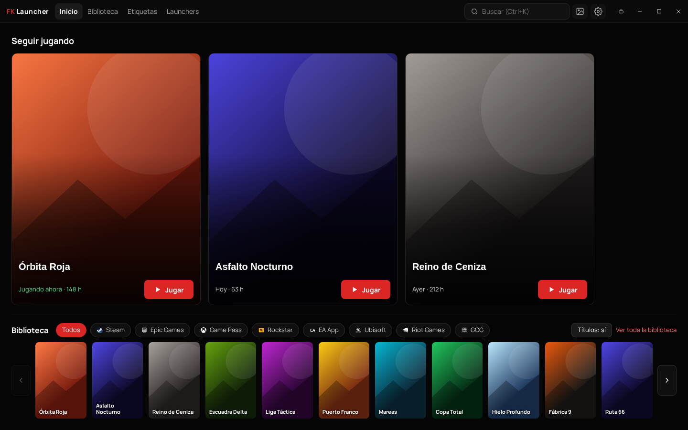
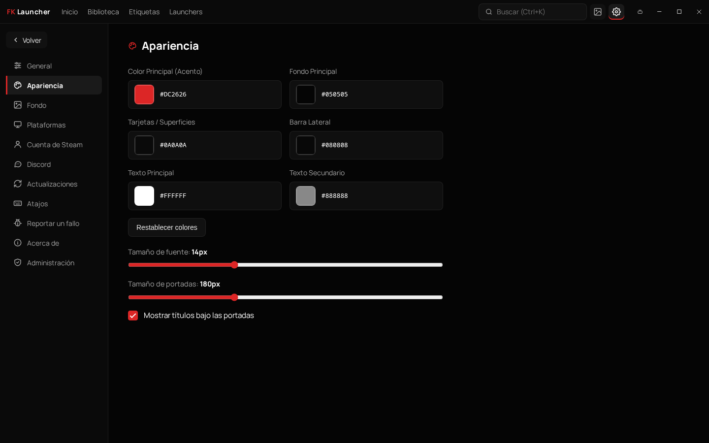
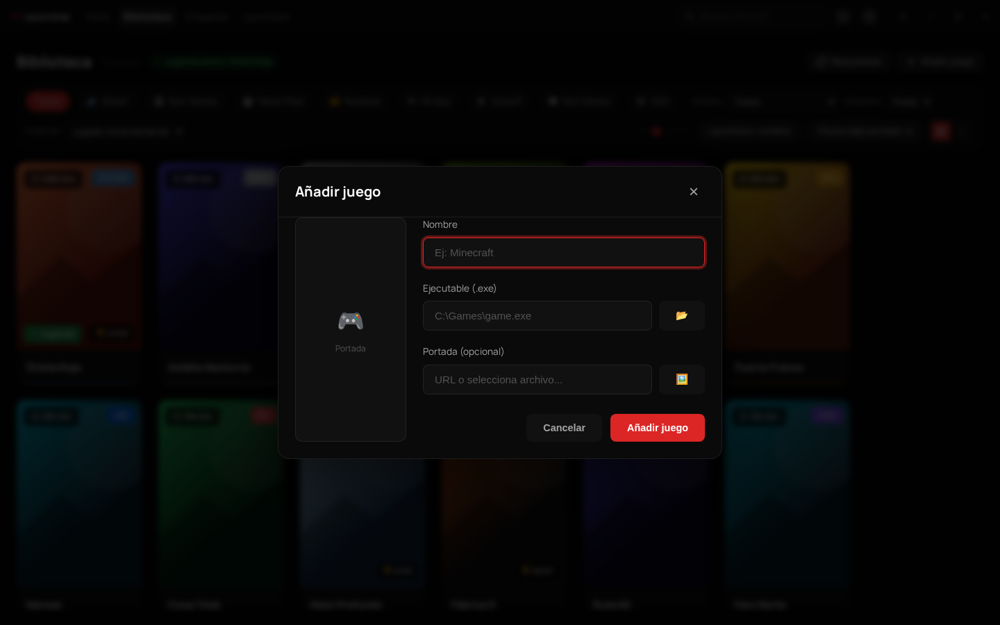

  <h3>🌍 English | <a href="#-fklauncher-español">🇪🇸 Español</a></h3>

 

  
    
  <h1>🚀 FKLauncher</h1>
  
<b>Eight game stores. One library.</b>

  
<i>Finds the games you have installed on Steam, Epic, Xbox, EA, Ubisoft, GOG, Rockstar and Riot, and opens them from one place, with their cover, hours and achievements.</i>

  
<a href="https://fk-launcher.vercel.app">fk-launcher.vercel.app</a>

---

## 📖 Overview

**FKLauncher** is a free Windows desktop app that brings together all your game clients (Steam, Epic Games, Xbox / Game Pass, EA, Ubisoft, GOG, Rockstar and Riot). It detects your installed games automatically, launches each one through its own store, and lets you add any other `.exe` yourself.

> 💡 **Want to try it out?**
> **[Download the latest version (FKLauncher v3.0.0)](https://github.com/FaKiNmc/Fk-launcher/releases/latest)** for Windows 10 and 11 (64-bit). FKLauncher is in Spanish for now.
> If you already have 2.0.3, it updates itself.

### Latest Version: v3.0.0 (Complete overhaul)
*   **New interface:** Home with "Continue playing", library in grid or list view, tags, a Launchers tab, and a full-screen page for each game.
*   **Backgrounds:** Your own image or video, a translucent window, or your Wallpaper Engine wallpapers, with rotation.
*   **Steam account (optional):** Sign in on Steam's official page to see the games you own even if they are not installed, with all their achievements.
*   **Now playing:** Detects the open game in any store and counts its playtime, also for games outside Steam.
*   **Discord in depth:** Cover, store icon, hours and achievements in your Rich Presence, with a live preview of how others see you.
*   **Report a bug:** Send a bug or a suggestion from Settings, with an optional diagnostic report you can review first, and follow its status.
*   **Safer:** Games are launched by their id (the interface never sends paths or commands), the window runs sandboxed with a strict content security policy, and no secret keys ship inside the .exe.

---

## ✨ Features

- 🎮 **Unified Game Library:** All your installed games in one place, in grid or list view, with filters by store and status.
- 🔗 **Platform Detection:** Rewritten scanners for `Steam`, `Epic Games`, `Xbox / Game Pass`, `EA App`, `Ubisoft`, `GOG`, `Rockstar` and `Riot Games`. A game bought on Steam but run through EA or Ubisoft shows up only once.
- ➕ **Add Custom Games:** Add any standalone `.exe`, with a clean suggested name and your own cover.
- 🖼️ **Covers:** Taken from your own Steam install first, then from the Steam and Epic stores and IGDB.
- ⏱️ **Hours and Achievements:** Playtime, last session and achievements, with "Most played" and "Recently played" sorting. Hours can be edited by hand.
- 🎨 **Customization:** Accent and background colors, font and cover size, and animated backgrounds.
- 🔍 **Quick Search:** Find any game instantly with `Ctrl+K`.
- 🔒 **Privacy:** No mandatory account and no ads. A single anonymous install number is sent to count users, and you can turn it off.

---

## 📸 Screenshots

### Settings & Customization
Settings are organized by section: general, appearance, backgrounds, platforms, Steam account, Discord, updates, shortcuts and bug reports.

### Adding Custom Games
Add any executable with its name and an optional cover, from a file or a URL.

*Screenshots of the real 3.0. The games and their covers are made up.*

---
---

 

  <h3><a href="#-fklauncher">🌍 English</a> | 🇪🇸 Español</h3>

 

  
    
  <h1>🚀 FKLauncher (Español)</h1>
  
<b>Ocho tiendas de juegos. Una biblioteca.</b>

  
<i>Encuentra solo los juegos que tienes instalados en Steam, Epic, Xbox, EA, Ubisoft, GOG, Rockstar y Riot, y los abre desde un mismo sitio, con su portada, sus horas y sus logros.</i>

  
<a href="https://fk-launcher.vercel.app">fk-launcher.vercel.app</a>

---

## 📖 Descripción General

**FKLauncher** es una aplicación gratuita de escritorio para Windows que reúne todas tus tiendas de juegos (Steam, Epic Games, Xbox / Game Pass, EA, Ubisoft, GOG, Rockstar y Riot). Detecta tus juegos instalados, abre cada uno con su propia tienda y te deja añadir cualquier otro `.exe` a mano.

> 💡 **¿Quieres probarlo?**
> **[Descarga la última versión (FKLauncher v3.0.0)](https://github.com/FaKiNmc/Fk-launcher/releases/latest)** para Windows 10 y 11 (64 bits).
> Si ya tienes la 2.0.3, te llega sola.

### Versión Actual: v3.0.0 (Renovación completa)
*   **Interfaz nueva:** Inicio con «Seguir jugando», biblioteca en cuadrícula o lista, etiquetas, pestaña Launchers y ficha de cada juego a pantalla completa.
*   **Fondos:** Imagen o vídeo propio, ventana translúcida o tus fondos de Wallpaper Engine, con rotación.
*   **Cuenta de Steam (opcional):** Inicia sesión en la página oficial de Steam y verás los juegos que tienes aunque no estén instalados, con todos sus logros.
*   **Jugando ahora:** Detecta el juego abierto en cualquier tienda y cuenta su tiempo, también en los que no son de Steam.
*   **Discord a fondo:** Portada, icono de la tienda, horas y logros en tu Rich Presence, con una vista previa en vivo de cómo te ven los demás.
*   **Reportar un fallo:** Envía un fallo o una sugerencia desde Ajustes, con un informe de diagnóstico opcional que ves antes de mandarlo, y sigue su estado.
*   **Más seguro:** Los juegos se abren por su identificador (la interfaz nunca envía rutas ni comandos), la ventana funciona aislada con una política de seguridad de contenido estricta y el .exe no lleva claves secretas dentro.

---

## ✨ Características Principales

- 🎮 **Biblioteca Unificada:** Todos tus juegos instalados en un mismo sitio, en cuadrícula o lista, con filtros por tienda y estado.
- 🔗 **Detección de Plataformas:** Escáneres reescritos para `Steam`, `Epic Games`, `Xbox / Game Pass`, `EA App`, `Ubisoft`, `GOG`, `Rockstar` y `Riot Games`. Un juego comprado en Steam que se abre con EA o Ubisoft sale una sola vez.
- ➕ **Añadir Juegos Personalizados:** Añade cualquier `.exe` con un nombre propuesto limpio y tu propia portada.
- 🖼️ **Portadas:** Primero del propio Steam de tu PC, y si falta alguna, de las tiendas de Steam y Epic y de IGDB.
- ⏱️ **Horas y Logros:** Tiempo jugado, última partida y logros, con los órdenes «Más jugado» y «Jugado recientemente». Las horas se pueden editar a mano.
- 🎨 **Personalización:** Colores de acento y fondo, tamaño de letra y de portadas, y fondos animados.
- 🔍 **Búsqueda Rápida:** Encuentra cualquier juego al instante con `Ctrl+K`.
- 🔒 **Privacidad:** Sin cuenta obligatoria y sin anuncios. Solo se envía un número anónimo de instalación para contar usuarios, y lo puedes apagar.

---

## 📸 Capturas de Pantalla

### Configuración y Personalización
Los ajustes van por secciones: general, apariencia, fondo, plataformas, cuenta de Steam, Discord, actualizaciones, atajos y reportar un fallo.

### Añadir Juegos Personalizados
Añade cualquier ejecutable con su nombre y una portada opcional, desde un archivo o una URL.

*Capturas de la 3.0 de verdad. Los juegos y sus portadas son inventados.*

---

  <i>Developed to keep gaming simple, clean, and unified.</i>
    
  
© 2026 Ismael Pérez (FKShield). All Rights Reserved.

